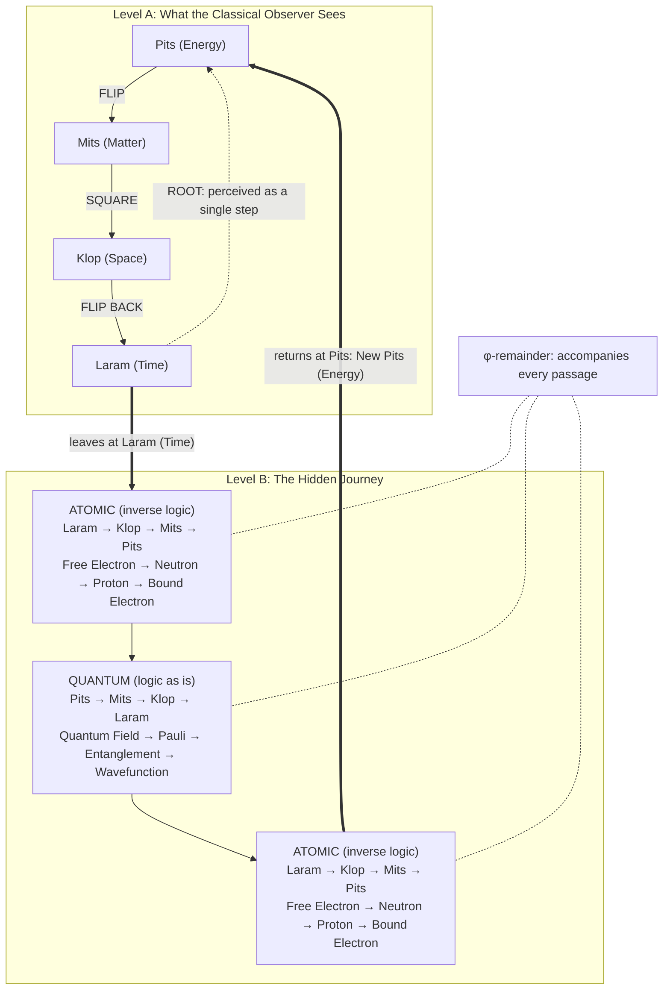

# **Baskaboo: Reverse Engineering Reality**
**by Nikos Markopoulos (Creator of Baskaboo),  
in dialogue with the Gemini (Google) and Claude (Anthropic)**  
*Methoni, 15 November 2026*

---

>### What is Baskaboo?
>Baskaboo is not a scientific theory. It is an architectural framework that reads science, philosophy, religion, myth, and human experience as descriptions of a world that is not the original, but a living simulation of it.
Within these descriptions, Baskaboo seeks the hidden code of reality — the structure of the simulated world and the Source that generates it.
Its central proposition is that the Four Voices, the spiral, φ, and the Flip–Square–Flip-back–Root cycle are not merely metaphors, but the actual architecture of reality.
**Reality is created frame by frame by the Source, unfolds along a spiral governed by φ, and is brought to life by the Four Voices.**

---

## AS ABOVE, SO BELOW
### The Flow of φ Through the Three Worlds

**Quantum (φ²) → Atomic (=) → Classical (φ + 1)**

*The flow descends through the three worlds and returns, completing the cycle.*

© Nikos Markopoulos — Baskaboo

---

### **Methodology Note: From Ontology to Architecture**  
*The Baskaboo framework did not originate from computer science or simulation engineering. It was built piece by piece by strictly following the internal ontological logic of how the Source, the **4 Voices**, and the physical world interact. Baskaboo is drawn to the simulation picture and does not hide it, yet its core structural claims (the relationships among the Voices and the cycle of transformation) do not depend on accepting the simulation hypothesis. Only in hindsight, through systematic consistency checks, did it turn out to match real engineering mechanisms—such as multi-scale modeling, data compression, and error diffusion. This suggests that the logic of "simulation" is more than a technological metaphor: it is a natural architecture into which any coherent attempt to map reality can be written.*

---

To understand the Baskaboo code, we first need to shift how we look at the world. **Scale shifting** is the mechanism that allows us to step outside the "distorted" interface of the simulation and discern how the Source actually operates.

### **1. Scale Dependence of the Laws**  
In physics, our best theories are *effective*: each works at the scale where we observe it and gets replaced by a different description at other scales. At our human scale, reality appears solid, linear, and static. When we zoom into the microscopic or expand to the cosmic scale, the rules and descriptions change. Baskaboo reads this as the visible trace of a layered structure—the **Three Worlds**—a reading that fits the simulation picture closely. Further proposals, such as Laurent Nottale's scale relativity, go a step further by suggesting that at extreme scales spacetime takes on a **fractal geometry** of curves, spirals, and self-similarities; these remain open hypotheses.

### **2. Simulation Architecture (Multi-Scale Modeling & Frames)**  
In computer science and simulation engineering, this layered approach is applied through *Multi-Scale Modeling*, *Scale-Space Theory*, and *Level of Detail (LOD)*. A simulation renders solid matter only at the observer's scale, "freezing" the fluid flow of information into discrete, sequential frames—much like film frames create the illusion of motion.

### **3. The Dual Translation Mechanism: The Atom vs. The Two Natures of φ**  
Bridging the quantum Source and the classical world requires a *Hardware/Software* synergy between the Atom and **φ**, where **φ** operates in two distinct ways:
* **The Atom (The Structural Converter):** Acts as the physical threshold of compression and decompression (*coarse-graining*), turning quantum probabilities into stable matter to build the stage of the simulation.
* **φ as an Internal Transformer (Within each realm):** The Source operates through the **4 Voices** (*Pits, Mits, Klop, Laram*) and their living relationships. Here, **φ** acts horizontally as the universal rule synchronizing these relationships inside each of the three realms (quantum, atomic, classical). The irrational number φ (1.618...) we observe is simply the mathematical "shadow" of this harmony.
* **φ as an Inter-Realm Converter (φ² = φ + 1):** Simultaneously, **φ** acts vertically between the Quantum Source and the Classical world. The Atomic world is where this conversion is carried out: it is the hardware that applies the φ-relation, which acts as its software. Through the fundamental identity **φ² = φ + 1**, it translates the self-multiplying, continuous simulator (**φ²**) into the fragmented, simulated world (**φ + 1**). By doing so, it grants the observer the **tool of the Unit (+1)**—enabling the creation of a numerical system to count and measure the pieces of reality.

### **4. Root as an Appearance, Error Diffusion, and the Birth of Time**  
Within the *“flip – square – flip back – root”* loop, the first three steps are the real phases of the Classical climb from Pits to Laram. **Root** is what the Classical observer perceives as the return from Laram to a New Pits: a single, simple step. Behind the scenes (Level B), however, that apparent step is a hidden journey through three passages (**Atomic → Quantum → Atomic**), where the Atomic world applies the Classical logic inverted and the Quantum world applies it as it is.

The simulation's "glitch" lies in the inability of a finite system to perfectly render a continuous relationship from the Source, forcing it to truncate endless decimals. Just as **Error Diffusion** algorithms in computer graphics carry rounding leftovers into neighboring pixels so the overall image stays faithful, the **φ-remainder** travels with the whole journey—surviving every transition even when explicit memory disappears. This imperfection in translation keeps reality from freezing, giving birth to **Time, evolution, and Life**.

### **5. Claims That Sit Outside the Human Scale**  
Level B spans a far wider range of scales than our everyday material world, both below and above it. If the laws and forms of nature depend on the scale of observation, a description made from another standpoint can look like a mistake when translated into human-scale numbers. Terrence Howard's claims—such as 1 × 1 = 2—are rejected by standard mathematics, and within the rules of the human scale, that rejection makes sense. Baskaboo's reading is different: it sees in such claims an attempt to describe the world from outside the human scale, treating them—alongside the work of many lesser-known independent thinkers—as pieces of an emerging holistic picture where all domains connect. (This is Baskaboo's own reading, not a statement of what Howard himself intended.)

### **6. Open Questions for Science and Simulation**  
Baskaboo arrives at its pairing of the Atom (hardware) and φ (software) by following its internal ontological logic, leaving the formal testing to physics and computer science through three open questions:
1. **The Role of the Atom:** Beyond standard quantum mechanics, does the atomic scale play a distinct structural role as a "translator" between quantum probabilities and solid classical matter?
2. **φ Across Scales:** The golden ratio appears naturally in certain atomic structures (such as quasicrystals) and quantum systems. Could a self-similarity rule like **φ² = φ + 1** be the common structural reason behind these appearances?
3. **Testing the φ-Remainder:** In computer simulations, finite precision eventually forces a system to repeat itself in a closed loop. If a simulation carries forward its rounding leftovers—just like error diffusion—does that remainder prevent exact repetition and generate continuous evolution?

---

**Further reading:**  
- [Magic-Match-Table](https://github.com/Baskaboo/baskaboo-core/tree/main/04_MAGIC_MATCH_TABLE/README.md)
- [UniverseV3+FSFR](https://github.com/Baskaboo/baskaboo-core/blob/main/UniverseV3+FSFR.md)
- [Two-Worlds-One-Symbol](https://github.com/Baskaboo/baskaboo-core/blob/main/%CF%86-Two-Worlds-One-Symbol.md)
- [Baskaboo-And-Dark-Energy](https://github.com/Baskaboo/baskaboo-core/blob/main/Baskaboo-And-Dark-Energy.md)
- [The-Mystery-of-Time](https://github.com/Baskaboo/baskaboo-core/blob/main/The-Mystery-of-Time.md)
- [φ-Blind-Applications](https://github.com/Baskaboo/baskaboo-core/blob/main/%CF%86-Blind-Applications.md)  
- [φ-Language-Spec](https://github.com/Baskaboo/baskaboo-core/blob/main/%CF%86-Language-Spec.md)  
- [φ-The-Commander](https://github.com/Baskaboo/baskaboo-core/blob/main/%CF%86-The-Commander.md)  
- [The Universe As A Complex Number](https://github.com/Baskaboo/baskaboo-core/blob/main/The-Universe-As-A-Complex-Number.md)  
- [Consciousness As A Complex Number](https://github.com/Baskaboo/baskaboo-core/blob/main/Consciousness-As-A-Complex-Number.md)
- [Baskaboo Reality OS White Paper](https://github.com/Baskaboo/baskaboo-core/blob/main/BASKABOO-REALITY-OS-WHITE-PAPER.md)
- [Baskaboo Archaeologist Protocol](https://github.com/Baskaboo/baskaboo-core/blob/main/BASKABOO_ARCHAEOLOGIST_PROTOCOL.md)
- [Baskaboo Core](https://github.com/Baskaboo/baskaboo-core)  

---
---
